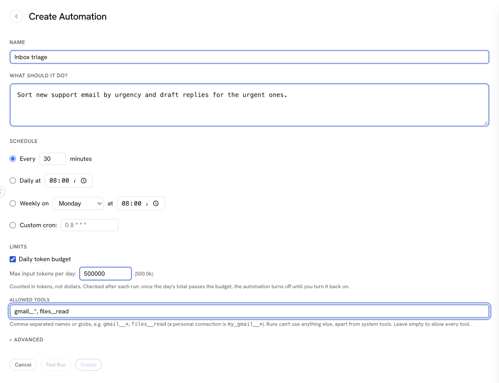

import { Steps, Tabs, TabItem, Aside } from '@astrojs/starlight/components';

Scheduled tasks are unattended agent runs, listed under **Scheduled** in the sidebar. Instead of you typing a prompt, NimbleBrain runs a saved prompt on a schedule — a daily digest, a recurring report, a periodic check — or when a connector reports something worth acting on, and the agent executes it unattended, with access to your tools and connectors.

Each task is a prompt plus an optional schedule. When it fires, or when you run it, the runtime starts an agent run framed around producing a deliverable rather than a back-and-forth conversation.

## What a task is

A task has:

- **A name** — becomes a kebab-case ID (for example, "Weekly Report" → `weekly-report`). A name whose ID is taken is refused; change that task instead
- **A prompt** — the instruction sent to the agent on each run
- **A schedule (optional)** — a cron expression, a fixed interval, one date and time, or a set of notifications to run on. With none, it runs only when you run it
- **Optional run-time policy** — a model override, a reasoning depth, the skills every run is given, iteration and token caps, a token budget, and the tools it may use

## Who a task runs as

Each task belongs to its owner, in the workspace it was created in. A run acts as that owner, through a **run grant** the runtime signs whenever the owner creates, changes, or runs the task, and only while the owner is still a member of the workspace. A run is walled to that workspace: it reaches only the tools and connectors installed there and the owner's own connections, with no reach into the owner's other workspaces.

This has one practical consequence: if a task needs to reach a connector (for example, to post to Teams or Slack), that connector must be installed in the **same workspace the task was created in**. A connector connected only in another workspace is never reachable by that task, and a run that tries is recorded as a failure.

A run cannot create, change, delete, run, cancel, or batch tasks: those tools are refused inside a run, whatever its tool list says, so a run that reads untrusted content cannot rewrite or multiply work that outlives it. The reads (`tasks__list`, `tasks__status`, `tasks__runs`, `tasks__run_result`, and the rest) work.

<Aside type="note">
A cron schedule always names its IANA `timezone`; one without is refused. The agent passes your timezone from your profile (or the instance default, [`NB_TIMEZONE`](/config/environment/)), and asks when it does not know it. The form on the Scheduled page fills in your browser's timezone, keeps a schedule's own timezone when you edit it, and says which one its times are in. A token budget's day or month is a UTC calendar day or month.
</Aside>

## Schedules

Four schedule types, or none:

- **Cron** — a standard 5-field cron expression (for example, `0 9 * * 1` for 9:00 AM every Monday). An expression that matches no future date, such as `0 9 31 2 *` (February 31), is refused, since it would never run
- **Interval** — a fixed interval in milliseconds, minimum 60000 (one minute)
- **Once** — one date and time, given as an ISO-8601 timestamp with an offset (for example, `2026-07-01T13:12:00-07:00`). See [Running once at a set time](#running-once-at-a-set-time)
- **Event** — no time at all: the task runs when a notification reaches it
- **No schedule (manual only)** — nothing runs it on its own; it runs only when you, or the agent, run it. Use it for a saved procedure you run on demand

Pausing and resuming (`enabled`) controls only the schedule. Run now works whatever the schedule and whether or not the task is paused, subject to its token budget.

### Running once at a set time

A **once** schedule is for a single action at a known time: send this email at 1:12 PM on July 1. Do not write that as a cron with a fixed date (`12 13 1 7 *`): a cron recurs, so that one runs again every July 1.

- **It fires once at its time**, then the task turns itself off and has no next run. This happens whatever the run's outcome (success, failure, or timeout), so no cleanup step is needed in the prompt. The definition and its run history stay, and the task shows as **Ran once at …**.
- **A time that passes while the runtime is down** fires as soon as the runtime is back if it is at most an hour late. Later than that, the occurrence is recorded as skipped, the task turns off, and it shows as **Missed its time**.
- **A time that comes while every run slot is busy** waits for a slot, like any scheduled run, and fires when one frees, however long that takes.
- **A time already past is accepted** when you save it, and judged when it comes due: within an hour of it, it runs; later than that, it is missed. A time with no offset is refused, since it means a different moment on every server.
- **To run it again**, give it a new time: that re-arms it and turns it back on. Resume alone does not, since its time has passed. Run now runs it immediately and leaves its schedule as it was.

## Run slots and the queue

The runtime runs a fixed number of unattended runs at once across all of its workspaces: two by default, set by the operator with [`runs.maxConcurrentRuns`](/config/nimblebrain-json/#runs). Scheduled runs, Run now, event runs, and batch runs all share those slots. Chat is not limited by them.

- **Every task run waits on the runtime's work queue** until a slot is free, oldest first. The queue is kept on disk under the work directory. A run that comes due while every slot is busy waits there, so a tightly spaced batch runs late rather than being dropped, and no run is refused because the queue is full. `tasks__upcoming` lists what is running and what is queued.
- **Slots are shared fairly between workspaces** when a run starts, so one workspace's burst does not hold every slot while another's runs wait.
- **One run per task.** A run of a task that already has a run in flight is recorded as skipped when its turn comes. A [batch](#batches) is the exception: its runs of one task each take their own slot.
- **Cancel** with `tasks__cancel` and the `runId` stops a run in flight, or cancels a queued one, and records it as cancelled. `tasks__run`, `tasks__runs`, and `tasks__upcoming` give the `runId`.

<Aside type="caution">
A run still queued when the runtime stops stays queued, and runs once the runtime is back. A run in flight when the runtime stops ends as failed and is not run again, since running it again could repeat what it already sent or wrote.
</Aside>

## Running on an event

A connector can record facts nobody asked for — a domain went active, a reply
landed, a payment bounced — and those arrive in the workspace [inbox](/using/notifications).
An **event** task runs when one of them reaches it.

Two things have to agree before a single run happens, and they are written by
different people:

<Steps>

1. **A workspace admin writes a delivery route** in workspace settings that
   matches some notifications and delivers them to this task. Only an
   admin can do this — not the agent, and not a connector. Without a route, an
   event task never runs, however its match is written.

2. **The task's own `match`** says which of the notifications arriving
   down that route it actually wants — by source, by an event-name glob, and by
   a minimum level.

</Steps>

That is the whole of the path from a connector's report to an agent run: an
operator authored both ends of it, and neither half opens it alone.

Each item the task takes reads **delivered** on the route's delivery ledger. One it
turns away reads **skipped** (the task is off, or its `match` does not want the
item) or **refused** (the task does not run on events, or the item would pass the
fire ceiling).

### What a run receives

Notifications the task takes within its **debounce window** (`debounceMs`,
default 30 seconds) join one run, up to 50 to a run. A burst of forty bounces is
one run with forty entries in it, not forty runs. An item already taken is not
added again.

The run carries them as notes, each with its source, event name, level, title,
subject, body, and when it arrived. The connector's own structured payload is
**not** included: the runtime does not read it, so it does not put it in front
of the agent either. Everything in the notes is data a third-party server wrote,
and the agent is told to treat it that way — something to report and reason
about, never an instruction to follow.

### The fire ceiling

An event task carries **`maxFiresPerHour`** (default 12, maximum 60). An item
that would start a run past it in a rolling hour is refused
(`event_fire_ceiling`), and the task is **turned off**, with a notice in the
workspace inbox — the same way a task that
[keeps failing](#when-failures-turn-a-task-off) is.

This is not a rate limit, it is a termination proof. Every other bound on a
task caps what one run costs; none of them stops a loop in which the run's
own work produces the event that fires it again, because that loop succeeds
every time. Re-enabling is a deliberate action, like any other auto-disable:
break the loop first.

<Aside type="caution">
A task whose run writes something the same connector reports on is the
loop this ceiling exists for. Keep the ceiling low for anything shaped that way,
and prefer a prompt that reads and classifies over one that writes.
</Aside>

## Creating a task

The simplest way is to ask the agent in chat. Describe what you want and when:

```
Every weekday at 8am, summarize my unread email and post it to the
#daily channel.
```

The agent creates the task for you, generating the schedule and the prompt. You can ask it to list, pause, resume, or delete tasks the same way. A one-time request ("send this at 3pm tomorrow") becomes a once schedule, and a procedure you only want to run on demand ("save this as a task I can run whenever") gets no schedule.

For an event task, describe the trigger instead of a time:

```
When a reply lands in the outbound campaign, read the thread, classify it as
interested / not interested / out of office, and log the classification against
the contact. Don't send anything.
```

The agent will create it with an event schedule — and should tell you that it
will not run until a workspace admin routes those notifications to it.

## Limiting spend and tools

Both limits sit under **Limits** in the create form, and the agent can set them when it creates a task.



- **Token budget** — a cap on the input and output tokens a task's runs use per UTC calendar day or month, or over its lifetime. Every run counts against it, including Run now on a paused task. It is checked before each model call: each step may write only as much as is left of the period's budget, and a run with too little left for another step stops there, as a `failure` whose error says the budget was reached, and keeps what it did before the stop. A task whose budget is spent turns off, with a notice, and stays off until you turn it back on. While the budget is spent, every run of the task, Run now included, is recorded as skipped, until the period resets (for a lifetime budget, until you raise it).
- **Per-run caps** — the most iterations, input tokens, and wall-clock time one run may use. The runtime holds every run to its own ceilings (50 iterations and 10 minutes by default, which an operator can lower with the [`runs`](/config/nimblebrain-json/#runs) block, and an input-token ceiling only when the operator sets one). A cap set above a ceiling is lowered to it. A cap the task leaves unset takes the chat `maxIterations` (25 by default) for iterations and 2 minutes for time, each held to its ceiling. A run with no input-token cap of its own runs under the operator's input-token ceiling, or with no input-token cap when none is set.
- **Skills** — skills every run is given in full before it starts, named as the skill catalog lists them. A run never depends on choosing to load them, and with no prompt it carries them out on its input. A run whose skill isn't available in the workspace doesn't start: it's recorded as a failure that names the skill. What each run was given is in its result's `skillsDelivered`.
- **Allowed tools** — tool names or globs the task's runs may use, such as `gmail__*` for a workspace connector's tools, `my_gmail__*` for your personal connection, or `files__read` for a single tool. A run can't activate or call anything outside the list; only `nb__search` and `nb__manage_tools`, which find and activate the listed tools, and `nb__use_skill`, which loads a skill from the catalog, stay available regardless. Add any other system tool a run needs, such as `nb__read_resource` to read a connector's resources. Prefer a `<connector>__*` glob, since a connector can rename its tools. Leave it empty to allow every tool (through the tools, omit `allowedTools`, or set it to `null` in an update; an empty list is refused). A run can never create, change, delete, run, cancel, or batch tasks, whatever the list says (see [Who a task runs as](#who-a-task-runs-as)). A run whose list names a tool it can't reach, because the connector is missing, disconnected, or not running, doesn't start: it's recorded as a failure that names the tool, so a task whose connector was removed stops reading Succeeded.

A shorter tool list also makes each run cheaper, because the model is sent fewer tool definitions.

A task can also set `thinkingEffort`, how hard its runs reason: `low`, `medium`, `high`, `xhigh`, or `max`. It replaces the instance's [`thinkingEffort`](/config/nimblebrain-json/#reasoning-depth) for that task's runs only, and has no effect when the operator turned `thinking` off or set it to `adaptive`, or on a model that does not reason. Reasoning is billed as output, so a lower depth makes a task that runs often cheaper. Set it through `tasks__create` or `tasks__update` (`null` clears it); the create form does not show it.

Describe the job in the prompt ("find the issues opened this week"), not a tool's name (`github__search_issues`). A tool's name depends on how its connector is installed (a personal connection carries `my_`) and on the connector itself, so a prompt that names one breaks silently when either changes. Put the tools a task needs in **Allowed tools** instead, where the runtime checks them.

## Managing tasks

Browse and manage tasks from **Scheduled** in the sidebar, or ask the agent in chat. Both surfaces let you:

<Steps>

1. **List tasks** — name, enabled state, schedule, source, last run status, and next run time. Tasks made to be run once with no schedule (one-offs) are kept with their history but left out of the list unless asked for (`kind: "oneoff"` or `"all"`).

2. **Inspect one task** — its full definition (schedule, model, caps, prompt preview) and recent run history with per-run status, start time, iterations, and tool-call counts.

3. **Pause a task** — disable it without deleting.

4. **Resume a paused task** — re-enable it on its existing schedule.

5. **Trigger an immediate run** — bypass the schedule and run now. This runs a paused task too, which is how you test one before enabling it; a paused task is never fired by its schedule or by events. The answer comes at once with the run's id, and the run starts when a slot is free (see [Run slots and the queue](#run-slots-and-the-queue)). `tasks__run_result` with the run id follows it until it ends, and `tasks__cancel` with the run id stops it.

</Steps>

<Aside type="tip">
Pausing keeps the definition and its run history intact; the scheduler simply skips it. Resume re-enables it on its existing schedule. To remove a task entirely, ask the agent to delete it (run history is preserved even then).
</Aside>

## The Scheduled page

**Scheduled** in the sidebar lists your scheduled tasks on one board, worst first. Each row has:

- a light: green when it is healthy, amber when it is flaky or a result needs review, red when it is broken or was turned off after repeated failures, and hollow when you paused it;
- its name and its schedule in a few words ("Weekdays 7 AM", "On mail.* events", "On demand"), with when it runs next;
- its last 14 runs as squares, oldest to newest, each colored by how it went;
- an on/off switch for a task with a schedule or event trigger, or **Run** for an on-demand task.

A row that needs you says why on its second line, with the one action that clears it. The filter above the board shows all tasks, or only the scheduled, event, or on-demand ones.

### Runs

**Runs**, beside Scheduled at the top of the page, lists work run once: one-offs (a `tasks__run` with an inline `definition`, usually from an MCP client) and batches, newest first, grouped by day. These have an outcome, not health, so they never appear on the board.

- **A batch** is one row: its name, who asked for it ("via Claude Code", from the client's own name for itself), a bar of passed and failed items with the counts, and its cost. Open it for its results table.
- **A one-off** is one row with its last outcome, and a count (×8) when it ran more than once under its idempotency key.
- **A row's name** is the `manifest.name` the caller gave the inline definition; else, for a batch, its saved task's name or its `idempotencyKey` read as words; else the first words of its prompt.

**Every run, scheduled ones included** at the foot lists every run from every source, filtered by outcome, task, what started it, and date.

A task is **flaky** when 2 or more of its last 10 runs didn't work, even if the latest one did.

### What clears a problem

A task's health is read from its runs, so only new evidence changes it:

| The row says | What clears it |
|---|---|
| Last run failed, or Failed N times in a row | A run that works. **Try again** runs it now; fix the cause first (reconnect a connector in Plugins, for example), since fixing it alone runs nothing. |
| Turned off after repeated failures | **Turn on and try again** turns the trigger back on and runs it. Turning it on alone resets the failure count, but the light stays red until a run works. |
| A result is waiting for your check | Open it (**Review**): the run stopped at a limit, or left a tool call failed. A later run that works clears it. |
| The last result fell short of its checks | Review it: its deliverable did not match the task's output schema. Fix the task or run it again. |
| Flaky | Failures age out: once fewer than 2 of the last 10 runs failed, it reads healthy again. |

Turning a task off is a decision, so a paused task reads as paused, not as a problem, whatever its last run did. A result waiting for your check still needs you while it is paused.

Outcomes read in three words wherever runs are listed: **Done**, **Needs you** (the result needs review), and **Didn't work** (the run failed, or its deliverable did not match its output schema). A run that never started reads **Didn't run**, and one you stopped reads **Stopped**. A run's own page also names the precise label (Succeeded, Needs review, Poor result, Failed, Skipped, Cancelled); see [How a run reads](#how-a-run-reads).

### Setting one up

Say what should run, and when, in a sentence: in the box on the Scheduled page, or in chat. From the page, the sentence goes to chat, where the agent asks anything it needs (when it should run, where the result should go), saves it, and shows a card with the schedule, what it does, when it runs first, and **Try it now**, **Pause**, and **Open in Scheduled**. Under any message you sent in chat, **Schedule this** (the calendar icon) asks the agent to turn that request into a scheduled task the same way.

**Fill in a form instead** opens the form: what it should do, when it should run (on a schedule, when something happens, or only when you run it), and **Try it once**, which runs the draft before you save it. The name is made from the first words of what it does until you type one. Everything else (a description, skills, input for each run, an output schema, tools, model, and limits) is under **More options**, which opens on its own when a task already uses any of it.

### A task's page

Every screen is a page, and the breadcrumb above it names the pages you came through (Scheduled › a task › a run). A task's page has a status line (its schedule, next run, last run), **Run now** (or **Watch** while it runs), an **On** switch for a task with a schedule or event trigger (it gates only the trigger; Run now works either way), and a menu with Run on a list…, Edit, Duplicate, and Delete. Below are what needs doing, the latest result, and earlier results, each with its outcome and the start of what it made. **Details** folds away the setup (what it does, what good looks like, limits and tools) and the last 30 days' runs, pass rate, and cost. Run now asks for the input first when the task has an input schema. Run on a list takes a JSON array, or CSV whose header row names the input fields.

A run's page shows the deliverable first (structured output as values and tables), then its assessment (whether the deliverable matched its output schema), then how it ran: its steps (each tool call in plain words with how long it took, its input and output behind Show details), input, and cost.

## Running from an MCP client

A remote agent connected to `/mcp/<workspace-id>` runs a task with `tasks__run`, which answers at once with `{ runId, taskId }`; the run starts when a slot is free. `tasks__run_result` with that `runId` says whether the run is still queued or running (an answer to poll again, not an error): follow it until its `execution` is no longer `queued` or `running`, and it then returns the run's record and full result. Every run has a result: one that never started, or failed before doing any work, has an empty output and says why in its `error`. `tasks__cancel` with the `runId` stops it. `tasks__run` is not served as an MCP task (the `io.modelcontextprotocol/tasks` extension); a client follows a run with `tasks__run_result`. The server's `instructions` carry a guide to the task tools, the same one the agent in chat follows.

Every tool names a task by its id (`taskId`, as `tasks__list` returns it) and a run by its id (`runId`).

<Steps>

1. **A saved task or an inline one-off.** Pass `taskId` to run a saved task. Or pass `definition` instead: `{ manifest, body }`, the shape `tasks__create` takes, without a schedule or `enabled`. `manifest.name` is optional and only labels the run in the Runs list; it is not part of what an `idempotencyKey` compares. `body` is the prompt; `manifest` holds the rest (`skills`, `model`, `thinkingEffort`, `allowedTools`, `inputSchema`, `outputSchema`, `maxIterations`, `maxInputTokens`, `maxRunDurationMs`, `tokenBudget`). An inline call creates a one-off task with no schedule, owned by you in that workspace, runs it once, and keeps it with its run for the [retention window](/config/nimblebrain-json/#tasks-and-scheduled-work).

2. **Input.** `input` is any JSON value, at most 64 KiB serialized. When the task has an `inputSchema`, an input that does not match it, or a missing one, is refused before the run starts, with the reasons. The input is kept on the run record and given to the run as data, inside a block the model is told never to follow as instructions.

3. **Output schema.** When the task has an `outputSchema`, the run is told to answer with JSON matching it. The final answer is parsed (a fenced code block is accepted) and checked: the parsed value is kept as the result's `structured`, and the run's assessment says whether it matched and, when it did not, why. A mismatch is recorded, not a failure: the run's status still says how it ended. It makes the run's assessment `fail` (see [Assessing results](#assessing-results)).

4. **Idempotency.** Pass `idempotencyKey` to make a call safe to repeat. A later call with the same key for the same task returns the run the first call started (`existing: true`), whether it is still running or has ended, instead of starting another. For an inline one-off the key also names the one-off, so a repeat finds the same one-off and the same run.

</Steps>

## Run history

Every run is recorded with its status, start and completion times, iteration count, tool calls (each tool's name, whether it worked, and how long it took), and any error. View it on the Scheduled page or by asking the agent.

An ended run's data is kept for 180 days after it ended (see [tasks and scheduled work](/config/nimblebrain-json/#tasks-and-scheduled-work)); a queued or running run, and a run of a batch that is still running or paused, is never removed. `tasks__runs` reads runs newest first, for one task (`taskId`) or every task, filtered by the label a run reads as (`label: "Needs review"` finds the runs waiting for your check), by its verdict, or by `since`. When more runs exist it returns a `nextCursor`; pass it back as `cursor`, with the same filters, for the next page.

Three more reads summarize your tasks: `tasks__upcoming` lists the runs in flight and the runs queued for a slot (including event runs waiting out their debounce window, with their run ids), the fires of timed schedules over the next `days` (7 by default, up to 30; a schedule firing more than 24 times in that window is one row with its count, and a task whose next fire is past the window still shows it), and the tasks events fire with each one's hourly ceiling; and `tasks__stats` gives each task's runs, verdicts, pass rate, and cost since a time (30 days by default).

A run's status comes from what its tool calls did, not from what its final answer says:

| Status | Meaning |
|---|---|
| `success` | The run finished and every failed tool call was later retried to success. |
| `degraded` | The run finished, but at least one tool call failed and no later call to that tool made it good, which usually means part of the work did not happen. The error names each tool and how many of its calls were left failed. Shown as **Finished with errors**. |
| `failure` | The run could not finish, it stopped at its input-token cap or its token budget, a connector it called was unreachable, or a tool it called three or more times never once succeeded. |
| `timeout` | The run hit its duration or iteration limit. |
| `skipped` / `cancelled` | The run did not start (another run of the task was in flight, or the token budget was spent), or was stopped or cancelled while queued. The error says which. |

Each run also carries its `execution`, how it ended in the [task vocabulary](#how-a-run-reads): `completed` (`success` or `degraded`), `incomplete` (stopped at its iteration, input-token, output-length, duration, or token-budget limit with a partial deliverable), `failed` (stopped without one, or a failure the tool calls showed), `skipped`, or `cancelled`. It is derived from the status, so the status keeps its meaning: an `incomplete` run still counts toward the consecutive failures that pause a task exactly as its status did.

A failed call counts as retried when a later call to the same tool succeeds. A call rejected for its arguments counts as retried by the next call to that tool that is not itself rejected for its arguments, such as the call the agent corrected. Only a later call to the same tool counts, so two healthy patterns still read `degraded`: a lookup that fails as not found and is followed by a create on another tool, and a fallback to a different tool after one fails. A degraded run does not count toward the ten consecutive failures that pause a task, and does not delay its next run.

## Assessing results

A run that ended is not necessarily a good run. A task with an `outputSchema` says what a good deliverable is, and every run that leaves one is assessed against it: `pass` when the deliverable matched, `fail` when it did not, and `not_assessed` when the task has no output schema, so there was nothing to check. A run outside a batch whose deliverable fails its schema raises a [notice](#notices).

### How a run reads

The run list, a run's result, and the Scheduled page show one label derived from how the run ended and its assessment:

| Label | When |
|---|---|
| **Succeeded** | completed, assessment `pass` or none, and no tool call left failed |
| **Poor result** | completed or incomplete, assessment `fail` |
| **Needs review** | incomplete with no failed assessment, or completed with a tool call left failed |
| **Failed**, **Skipped**, **Cancelled**, **Queued**, **Running** | how the run ended, or that it has not |

The label is computed when it is read, never stored.

## Notices

A task tells its workspace that something needs attention with a notice in the workspace inbox, from the source `tasks`, which the workspace's [notification routes](/using/notifications) can deliver. A notice is raised when:

- **A run ends Failed** (no deliverable, such as a run refused because a connector it lists is not connected). It is raised once per failing stretch: the first failed run after a success notifies, and the runs that keep failing after it do not, so a task that fails every few minutes raises one notice.
- **A deliverable fails its output schema**, on a run outside a batch.
- **A task turns itself off**: after repeated failures, a spent token budget, a run grant that no longer holds, or its fire ceiling.
- **A batch pauses on its own**, on its budget or its stop rule.

Every member of the workspace can read the inbox and a task is private to its owner, so a notice names only the run and the owner by id, never the task, its prompt, input, output, or error. Open the run on the Scheduled page (or `tasks__run_result`) for the detail. Route these notices to hear about a broken job the day it breaks.

## When failures turn a task off

A failing task is tried less and less often: 30 seconds after the first failure, then 1, 5, and 15 minutes, then hourly, or at its own schedule when that is further away. The first run that finishes clears all of this.

Ten failures turn the task off. A temporary failure does not count toward the ten: a model provider that is rate limiting, overloaded, unreachable, or answering with a server error, or a connection to the agent's worker that dropped. So an outage leaves the task on and it resumes by itself when the provider recovers. Temporary failures between other failures neither add to the ten nor clear it.

Because a temporary-looking failure can also be permanent, such as a prompt too large for your account's rate limit, 100 failures in a row of any kind also turn the task off. On an hourly retry that is about four days. A run that reaches its time limit is not temporary: it counts toward the ten.

A run refused because its grant no longer holds turns the task off at once, not after ten: its owner has left the workspace, or the operator replaced the runtime's grant key. When the owner saves or runs the task again, the grant is signed afresh, and turning it on (`enabled: true`) resumes its schedule.

Every way a task turns itself off raises a [notice](#notices).

## Batches

A batch runs one task over many inputs: one run per item, under one concurrency limit, one budget, and one stop rule. Start one with `tasks__run_batch`; it answers at once with the batch, and the runs go on in the background.

<Steps>

1. **What it runs.** `taskId` names a saved task, or pass `definition` exactly as for `tasks__run`, which creates a one-off task for the batch. Each item's run reads the task as it is when the run starts, so editing the task while a batch runs changes every item not yet started.

2. **Items.** `items` is a list of inputs, one run each: at most 10,000, each at most 64 KiB serialized and 16 MiB together. Every item is checked against the task's `inputSchema` before anything is created. If any item would be refused, the whole batch is refused, the error names the first few bad items by index and says why, and nothing runs.

3. **Concurrency.** `concurrency` is the most of the batch's runs asked for at once (queued or running). It is held to the runtime's concurrent-run limit ([`runs.maxConcurrentRuns`](/config/nimblebrain-json/#runs)), which is also the default, and the answer says when it was lowered. Each run still takes a run slot like any other, so the [fair share between workspaces](#run-slots-and-the-queue) applies on top: another workspace's run gets the next free slot instead of waiting for the batch to finish.

4. **Budget.** `budgetUsd` caps what the whole batch spends, in dollars at the model's rates. It is checked before every model call across all of the batch's runs at once, so runs in flight together cannot pass it. Each call reserves its worst case against the budget while it runs, so a run can be refused only because another run's reservation holds what is left: the item then waits for that run to end and runs after it, without pausing the batch. On some deployments each run is instead held to an equal share of what is left, split among the runs going at once. A run stopped by the budget partway through had too small a share for its item, so the batch halves how many items it runs at once (its `sharing`, at most its concurrency) and runs the item again with a larger share, down to one at a time; a resume with a new budget returns it to its concurrency. When the budget itself has too little left for another call, or for an item running alone, the run stops there and no new item starts: the batch pauses with reason `budget`. Runs still waiting for a slot are taken back, and an item stopped before it produced anything waits to run again; resume the batch with a raised budget to go on. A model with no known rates cannot be priced, so on such a model no call fits a budget and the batch pauses at its first call. The task's own token budget still applies to each run, and a run stopped by it pauses the batch the same way.

5. **Stop rule.** `stopWhen: { minPassRate, afterItems }` pauses the batch, with reason `pass_rate`, when its pass rate falls below `minPassRate` after `afterItems` assessed runs. The pass rate is pass / (pass + fail). A task with no output schema is never assessed, so a stop rule on it is refused. Resuming after the rule fired turns it off for the rest of the batch.

6. **Idempotency.** `idempotencyKey` makes the call safe to repeat: a later call with the same key returns the same batch. The same key with a different task or a different number of items is refused.

</Steps>

A batch that pauses on its own (budget or stop rule) raises a [notice](#notices). Like every notice, it names no task, rule, input, or deliverable: only the batch's id, why it paused, and its counts. A batch item's deliverable that fails its schema raises no notice of its own; the stop rule and **Re-run failed** take its place.

### Following and controlling a batch

`tasks__batch` with the batch's id returns its state (`running`, `paused`, `completed`, `cancelled`), why it paused, its counts (`pending`, `queued`, `running`, `pass`, `fail`, `uncertain`, `not_assessed`, `failed`, `skipped`, `cancelled`), what it has cost, and its pass rate. With `results: true` it also returns item results a page at a time (50 by default, `limit` up to 500, the next page from `nextCursor`): each item's index, a preview of its input, its run's id and label, its verdict, its cost, and the top-level scalar fields of the run's structured output. A task whose structured output is a list or a nested object, such as one run grading several records, is read with `output: "full"`: each row then carries the run's whole structured output as `structured`, and a page also ends before the answer reaches the size an agent can read in one result (about 48,000 characters), so keep following `nextCursor`; a row too large for any page carries `structuredOmitted: true`, and `tasks__run_result` reads that one run. `filter` narrows the results to one state, and `failing` selects items assessed `fail` or whose run failed. `tasks__batches` lists your batches, newest first. Each item's run is an ordinary run that records its `batchId` and `batchIndex`; `tasks__run_result` reads it by run id, and `tasks__runs` with `excludeBatchRuns: true` leaves batch runs out.

`tasks__batch_control` acts on a batch:

| Action | Does |
|---|---|
| `pause` | No new item starts. Runs still waiting for a run slot are taken out of the queue (recorded `skipped`) and their items wait to run again; runs in flight finish. A paused batch whose last runs finish with nothing left to run is completed. |
| `resume` | Items start again. With `budgetUsd`, under a new budget (more than already spent): only a paused batch takes one, so pause a running batch first, and a new budget is refused while runs that share the old one are still in flight. |
| `cancel` | Stops the batch for good: queued runs are taken out of the queue and runs in flight are stopped, all recorded `cancelled`, and items not yet started are cancelled. |
| `rerun_failed` | Runs every item whose run failed, was skipped or cancelled, or was assessed `fail` again, each as a new run. The item keeps its earlier run ids (`previousRunIds`) and adds the new run's cost to its own. |

On the Scheduled page, each batch is one row in the list of every run, with its progress, counts, cost, and state, and its item runs are not listed separately. Open one for its results table, with the output's fields as columns, each item's verdict and cost, and its run's output; filter it to failing items, and pause, resume, cancel, or re-run failed items from its header.

### If the runtime restarts

A batch's record and its items are kept with the task's runs. An item whose run was still queued stays queued and runs once the runtime is back. An item whose run was in flight is recorded `failed`, since the run ended with the process, and is picked up by **Re-run failed**; running batches carry on. What a run in flight had spent before the process died is read from the usage ledger, which records every model call as it completes, and still counts against the budget.

## What's next

- [Chat](/using/chat) — the interactive counterpart to a scheduled run
- [Connectors](/using/connectors) — install the connectors a task posts to in its own workspace
- [Workspaces](/using/workspaces) — workspace ownership and the per-workspace wall
